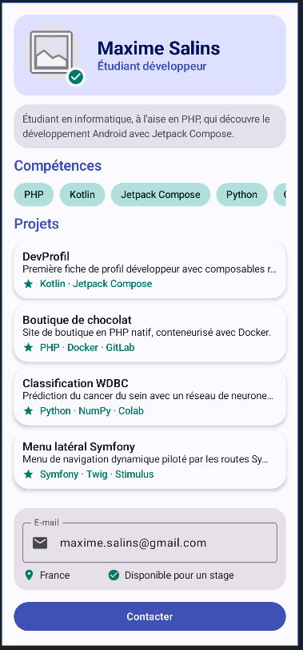
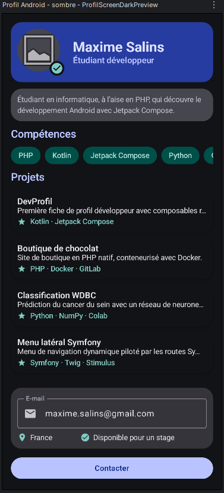

# DevProfil2 – Profil développeur (Jetpack Compose)

## Description

Application Android qui présente le profil d'un développeur sur un seul écran : avatar avec
badge de disponibilité, courte description, compétences, projets, zone de contact et bouton
d'action « Contacter ». Toutes les données sont locales (écrites en dur dans le code Kotlin,
dans `sampleProfil()`). Cette version améliore le premier devoir `DevProfil` (dépôt séparé).

## Composants Compose utilisés

- `Text` : nom, rôle, titres de section, descriptions
- `Button` : action principale « Contacter » (callback `onContactClick` vide, aucune logique)
- `Icon` : badge de disponibilité, icône du champ e-mail, icônes de localisation, de
  disponibilité et des technologies des projets
- `Image` : avatar placeholder (`ic_menu_gallery`), recadré en cercle avec `clip(CircleShape)`
- `Card` : description, cartes de projet (`ProjectCard`), zone de contact
- `OutlinedTextField` en lecture seule (`readOnly = true`) : e-mail
- `Surface` : en-tête du profil, badge de l'avatar, `TechnologyChip`
- `Scaffold` et `MaterialTheme`

## Layouts utilisés

- `Column` : structure verticale de l'écran (organisé pour tenir dans l'écran, sans scroll global)
  et des cartes
- `Row` : en-tête (avatar + nom), ligne des technologies d'un projet, ligne localisation / disponibilité
- `Box` : avatar avec badge de disponibilité superposé (`Alignment.BottomEnd`)
- `Spacer` : espaces entre les éléments
- `Surface` : zone visuelle cohérente avec le thème (en-tête du profil)
- `LazyColumn` et `LazyRow` : voir ci-dessous

## Listes

- **`LazyColumn` (projets)** : les 4 projets sont affichés avec `items(...)` et une `key`
  (l'id du projet). Chaque élément utilise le composable réutilisable `ProjectCard`. La liste
  prend la place restante de l'écran grâce à `Modifier.weight(1f)` : le reste de la page reste
  fixe et rien ne déborde. Si la place manque sur un petit écran, seule cette liste défile.
- **`LazyRow` (compétences)** : les compétences défilent horizontalement, chaque élément est
  un composable réutilisable `TechnologyChip`.

## Choix de thème

- **`MaterialTheme.colorScheme`** : palette indigo (couleur principale) et vert d'eau (couleur
  secondaire). Une version claire (`LightColors`) et une version sombre (`DarkColors`) sont
  définies à la main. Les couleurs dynamiques sont désactivées pour garder la même identité
  visuelle sur tous les téléphones.
- **`MaterialTheme.typography`** : titres en gras et tailles ajustées pour une bonne lisibilité.
- **`MaterialTheme.shapes`** : coins arrondis (8 / 12 / 20 / 28 dp) utilisés par les cartes, les
  chips et l'en-tête, pour un rendu homogène.
- Le thème suit le réglage du système (`isSystemInDarkTheme()`).
- Les couleurs sont toujours lues via `MaterialTheme.colorScheme` (jamais de couleur écrite
  directement dans les composables), ce qui permet au clair et au sombre de fonctionner sans
  code supplémentaire.

## Previews

2 previews sont fournies dans `MainActivity.kt` :
profil en thème clair, profil en thème sombre.

## Captures d'écran

## Quelles notions du chapitre Compose UI avez-vous réutilisées ?

J'ai réutilisé les composants fondamentaux (`Text`, `Button`, `Icon`, `Image`, `Card`,
`OutlinedTextField` en lecture seule), les layouts (`Column`, `Row`, `Box`, `Spacer`, `Surface`)
et les listes modernes (`LazyColumn` pour les projets, `LazyRow` pour les compétences) avec des
composables réutilisables (`ProjectCard`, `TechnologyChip`). J'ai aussi appliqué Material Design 3
(`colorScheme`, `typography`, `shapes`) avec un thème clair et un thème sombre, ainsi que les
callbacks et les previews vus dans le premier devoir.